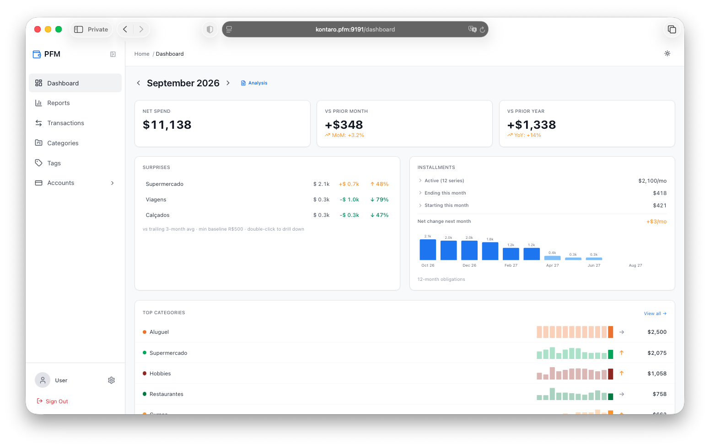
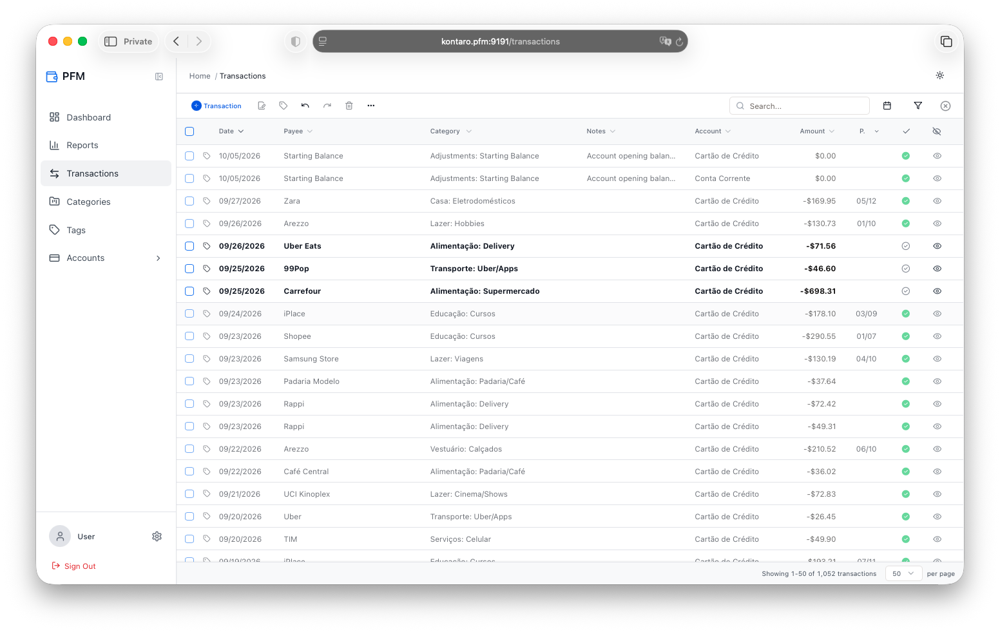
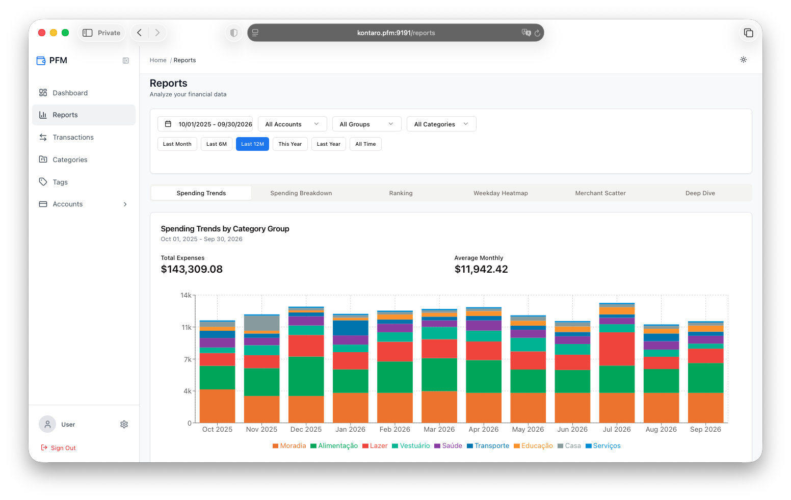
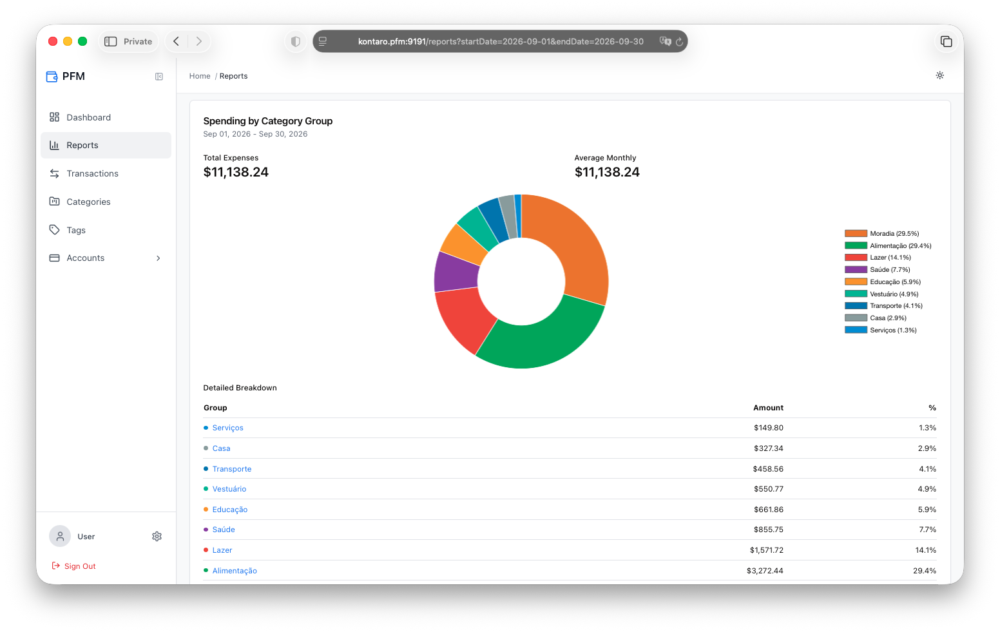
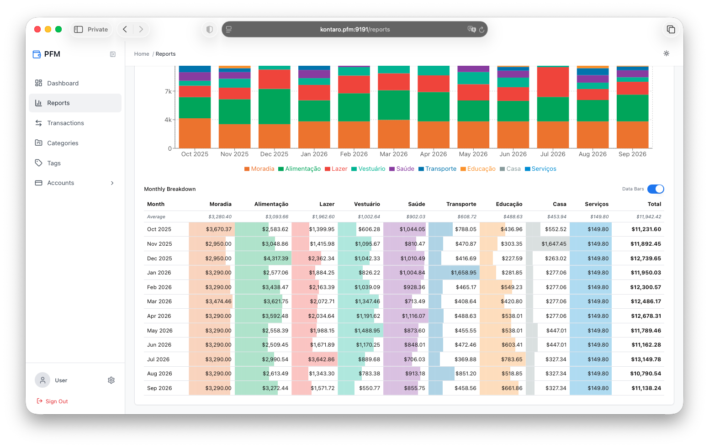
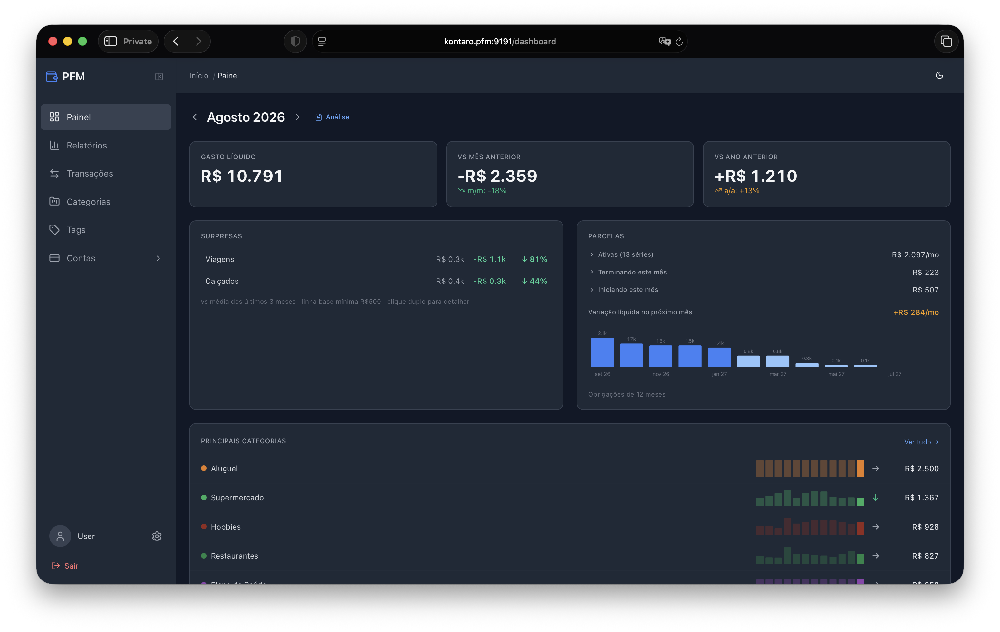
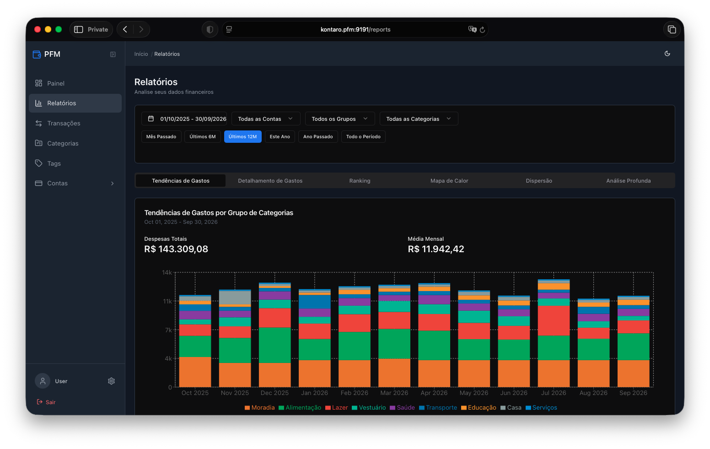

# Screenshots

A tour of Kontaro using the demo dataset (see `scripts/seed_demo.py`). Back to the [README](../README.md).

## Dashboard

The monthly overview: net spend, comparison against the prior month and prior year, **surprises** (categories deviating from your trailing 3-month average), the **installments** panel with a 12-month obligation forecast, and your top categories with 12-month sparklines.

## Transactions

The full ledger with inline editing, categories, tags, reconciliation status, splits and installment tracking. Bulk-edit and filters live in the toolbar.

## Reports

### Spending trends

Stacked spending by category group over the last 12 months, with quick period presets (last month, 6M, 12M, this/last year, all time) and account, group and category filters. Other tabs cover ranking, weekday heatmap, merchant scatter and deep dive.

### Spending breakdown

Share of spending per category group for the selected period, with a detailed table that links into the matching transactions.

### Monthly breakdown

A month-by-group matrix with heat-mapped cells, so seasonal spikes and drifting categories stand out at a glance.

## Dark mode and localisation

The UI follows your language and theme. Below: the dashboard and reports in Brazilian Portuguese with dark mode.

